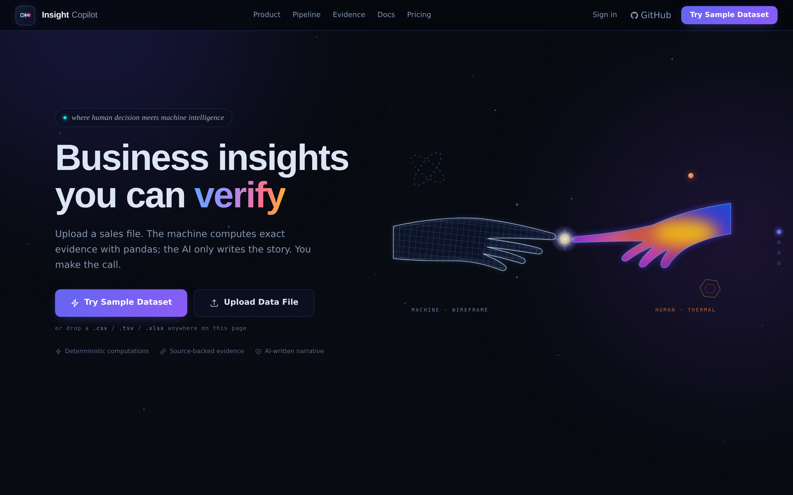
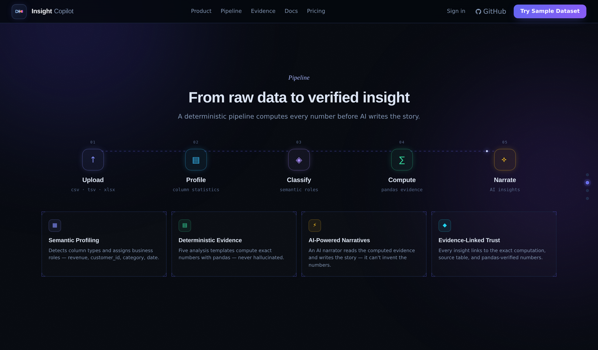
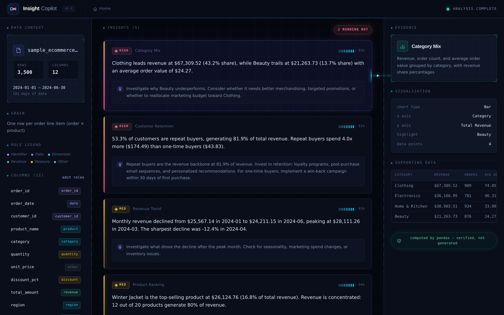
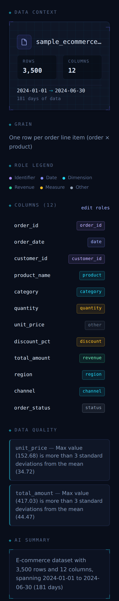
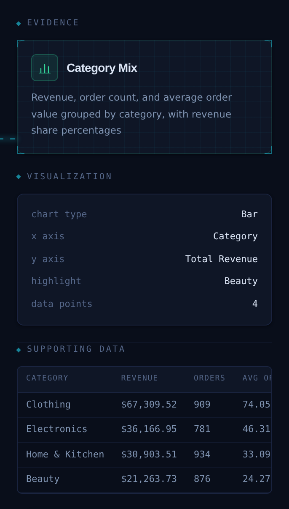

# Insight Copilot

**Evidence-first AI analytics — pandas computes the numbers, AI tells the story.**

**[Live demo](https://insight-copilot-eta.vercel.app)** · [Run locally](#run-locally) · [Screenshots](#screenshots)

Insight Copilot is an evidence-first AI analytics assistant. Pandas computes verified evidence from your data, Claude turns that evidence into a clear business narrative, and every insight links back to the exact computation, template, and data slice behind it — so nothing you read is a claim you have to take on faith. Built as an AI analytics product prototype demonstrating AI engineering, data pipeline design, and full-stack product development, currently applied to e-commerce business data.

You can also ask **Pip**, the built-in AI analyst, questions in plain English. Pip plans the analysis, pandas runs it, and every number in the answer is checked against the computed evidence before you see it.

> **This is not a ChatGPT wrapper.** The system never lets an LLM compute numbers. Pandas computes the evidence. The AI writes the narrative. Every insight links back to the exact computation that produced it.

---

## The Problem

Most AI analytics tools follow the same pattern: paste your CSV into a chat window, hope the model gets the numbers right. This approach has three failure modes that make it unsuitable for real business decisions:

1. **Numerical hallucination** — LLMs routinely miscompute aggregations, percentages, and growth rates. A model might report "revenue grew 23%" when the actual figure is 18%.

2. **No audit trail** — when a chatbot says "your top category is Electronics," there's no way to verify the claim without re-doing the analysis yourself.

3. **No persistent understanding** — every session starts from zero. The system doesn't build a structured model of what your data contains or what's been analyzed before.

Insight Copilot solves all three by separating concerns: deterministic computation (pandas) handles the math, semantic profiling (AI) handles understanding, and narrative synthesis (AI) handles communication — each doing what it's best at.

---

## Key Features

**Multi-format Data Ingestion** — Users can upload CSV, TSV, and Excel (.xlsx) files. The ingestion layer validates and parses files into pandas DataFrames before passing them into the same evidence-first analysis pipeline.

**Two-Stage Data Profiling** — After upload, a pandas-based profiler computes exact statistics (dtypes, distributions, nulls, cardinality, date ranges). Then an AI classifier assigns semantic business roles to each column using the statistical profile — not raw data. Supports both English and Chinese column-name semantic mapping.

**Evidence-Linked Insights** — Every insight carries a typed `Evidence` object containing the template that produced it, the exact data slice, chart metadata, and a description of the computation. The LLM receives these pre-computed evidence objects and writes narratives constrained to the numbers inside them, so it cannot hallucinate figures because it never computes them. The frontend renders each insight as an expandable audit trail with supporting data tables.

**Analysis Template Registry** — Five self-contained analysis templates (revenue trend, category comparison, top products, AOV analysis, repeat purchase), each declaring the semantic roles it requires. The registry auto-selects which templates can run based on the dataset's column classifications. Adding a new analysis is one file — no existing code changes.

**Pip, the Built-in AI Analyst** — Ask a question such as "Which region brings in the most revenue?" and Pip answers in a sentence or two, with a suggested next step. Pip is a tool-using agent: Claude decides which analysis to run, but it can only pick from two tools: the five analysis templates, or a structured query (sum, average, count, group by, filter, time grain). Pip never writes or runs code. Each answer shows the evidence it used and the steps it took.

**Automatic Number Check** — Telling a model "only use the numbers provided" is a request, not a guarantee. So after Claude writes an insight or a Pip answer, the app compares every number in the text with the evidence pandas computed. If a number is not in the evidence, Claude gets one chance to rewrite. If it still fails, an insight is replaced with a fixed template sentence, and a Pip answer is clearly marked as unverified.

**Net Revenue by Default** — Cancelled and refunded orders are not counted as revenue. This matches how Shopify, Etsy, and accounting standards report it. On the sample dataset this changes the headline from $155,643.71 (all orders) to $104,920.48 (completed orders). The excluded amount is never hidden: every piece of evidence states how many orders were left out and what they were worth.

**Handles Real-World Files** — Day-first dates (31/01/2024), currency text ("$1,204.50"), semicolon-separated files, and files saved from Excel in Chinese or Western European encodings are all read correctly. Dates that cannot be read are flagged instead of being silently dropped.

**Three-Panel Analytical Workspace** — A dark-themed React + TypeScript dashboard with Data Context (left), Insight Feed (center), and Evidence Details (right). The Data Context panel shows the dataset profile, semantic role legend, dimensions, and measures. The Insight Feed shows prioritized business insights with actionable recommendations. The Evidence Panel shows the computation description, key metrics, visualization metadata, and a supporting data table — with a trust badge confirming all numbers are pandas-verified.

**Landing Page with Product Preview** — A SaaS-style landing page with a split hero layout, embedded product mockup, pipeline visualization, and one-click access to a sample dataset. Users see what the product does before loading any data.

---

## Why This Is Different

| Approach | How numbers are produced | Audit trail | Adapts to schema |
|---|---|---|---|
| ChatGPT + CSV | LLM estimates from raw text | None | No |
| Notebook + pandas | Manual code per dataset | Code cells | Manual |
| **Insight Copilot** | Pandas templates, auto-selected | Every insight → Evidence object | Semantic role detection |

The architecture follows a production-oriented AI analytics pattern: separating deterministic computation from AI-generated explanation to improve reliability and trust.

---

## Architecture

```
CSV Upload
  → Deterministic Profiling (pandas: dtypes, statistics, date ranges)
  → Semantic Role Mapping (Claude API or mock classifier)
  → Evidence Templates (5 pandas-based analysis templates, auto-selected)
  → AI Narrative Generation (Claude API or mock narrator)
  → Number Check (every number in the text must appear in the evidence)
  → Evidence-Linked Dashboard (React three-panel workspace)

Question for Pip
  → Claude picks a tool (an analysis template, or a structured query)
  → pandas runs it and returns Evidence
  → Claude writes the answer from that Evidence
  → Number Check
  → Answer with evidence chips and a step-by-step trace
```

```
                         ┌─────────────────────────────────────────────┐
                         │              React + TypeScript             │
                         │  ┌───────────┬──────────────┬────────────┐  │
                         │  │   Data    │   Insight    │  Evidence  │  │
                         │  │  Context  │    Feed      │   Panel    │  │
                         │  └───────────┴──────────────┴────────────┘  │
                         └──────────────────┬──────────────────────────┘
                                            │ REST API
                         ┌──────────────────▼──────────────────────────┐
                         │              FastAPI Backend                │
                         │                                             │
  ┌───────────┐          │  ┌─────────────┐    ┌──────────────────┐    │
  │ Data file │──upload──│─▶│Deterministic│───▶│    Semantic      │    │
  └───────────┘          │  │  Profiler   │    │   Classifier     │    │
                         │  │  (pandas)   │    │   (Claude/Mock)  │    │
                         │  └─────────────┘    └────────┬─────────┘    │
                         │                              │              │
                         │                    ┌─────────▼──────────┐   │
                         │                    │  Template Registry │   │
                         │                    │  ┌───────────────┐ │   │
                         │                    │  │ revenue_trend │ │   │
                         │                    │  │ category_comp │ │   │
                         │                    │  │ top_products  │ │   │
                         │                    │  │ aov_analysis  │ │   │
                         │                    │  │repeat_purchase│ │   │
                         │                    │  └───────────────┘ │   │
                         │                    └─────────┬──────────┘   │
                         │                              │              │
                         │                    ┌─────────▼──────────┐   │
                         │                    │  Narrator          │   │
                         │                    │  (Claude/Mock)     │   │
                         │                    │  Evidence → Insight│   │
                         │                    └────────────────────┘   │
                         └─────────────────────────────────────────────┘

  Key: LLM calls are used ONLY for semantic classification, narrative
  synthesis, and (in Pip) choosing which analysis to run. All numerical
  computation is deterministic (pandas).
```

The pipeline in sequence:

1. **Upload** → CSV, TSV, or Excel files are parsed into pandas DataFrames. The profiler computes column statistics (dtype, min/max/mean, cardinality, nulls).
2. **Semantic Profiling** → Statistical profile (not raw data) is sent to Claude, which classifies columns into business roles: `total_amount → revenue`, `order_date → date`, `customer_id → customer_id`. A rule-based mock classifier supports development without an API key and handles both English and Chinese column names.
3. **Template Selection** → Registry filters analysis templates to those whose required semantic roles exist in the dataset
4. **Evidence Computation** → Selected templates run pandas aggregations, producing typed `Evidence` objects with exact numbers
5. **Narrative Synthesis** → Evidence objects are sent to Claude, which writes insight text constrained to the provided numbers. A mock narrator provides deterministic fallback.
6. **Number Check** → Every number in the generated text is compared with the evidence. Anything that does not match is rewritten once, then replaced or flagged.
7. **Dashboard** → Frontend renders a landing page, then a three-panel workspace with data profile, prioritized insights, and linked evidence
8. **Ask Pip** → Follow-up questions go to the agent, which reuses the same templates and evidence format, so its answers can be audited the same way

---

## Screenshots

The product tells one story across three views: the landing page shows *what it is*, the pipeline shows *how it works*, and the dashboard — including evidence-linked insights — shows *why you can trust it*.

### Landing Page


Purpose: Show the product vision and SaaS-style experience.

### How It Works


Purpose: Explain the data-to-insight workflow.

### Dashboard Overview


The workspace combines:
- dataset understanding
- generated insights
- evidence verification

### Semantic Data Profiling


### Evidence-Linked Insights


Purpose: Demonstrate the working product.

---

## Tech Stack

**Frontend** — React 18, TypeScript, Tailwind CSS, Vite, responsive SaaS-style landing experience

**Backend** — Python, FastAPI, pandas, Pydantic

**AI** — Anthropic Claude API for semantic classification, narrative synthesis, and the Pip agent (Claude tool use); rule-based mock versions of all three for offline development

**Data** — CSV upload, pandas DataFrames, built-in sample e-commerce dataset (3,500 rows)

**Design Patterns** — Strategy pattern (analysis templates), Registry pattern (template auto-selection), two-stage profiling pipeline, structured output validation with retry, tool-using agent loop with a step limit, post-generation number check

---

## Run Locally

**Prerequisites:** Python 3.11+, Node.js 18+

```bash
git clone https://github.com/grace056056/insight-copilot.git
cd insight-copilot
```

### Backend

```bash
cd backend
python -m venv .venv && source .venv/bin/activate
pip install -r requirements.txt

# Optional: enable Claude API (works without it using mock classifiers)
echo "ANTHROPIC_API_KEY=sk-ant-..." > .env

python -m uvicorn main:app --reload --port 8000
```

The backend starts at [http://localhost:8000](http://localhost:8000). Mock semantic classification and mock narrative generation are used automatically if no API key is set — the full pipeline works offline. Pip also works without a key: a keyword router picks the analysis instead of Claude.

Keep your API key in `backend/.env` only. That file is git-ignored, so the key is never committed.

### Frontend

```bash
cd frontend
npm install
npm run dev
```

Open [http://localhost:5173](http://localhost:5173). The landing page loads first — click **Try Sample Dataset** or upload your own CSV, TSV, or Excel file.

The Vite dev server proxies `/api` requests to the backend automatically.

### Tests

```bash
cd backend
pip install -r requirements-dev.txt
python -m pytest
```

The suite (85 tests) runs fully offline in mock mode. It checks the deterministic profiler, recomputes template outputs independently with pandas to confirm the evidence numbers are exact, exercises the defensive LLM-output parsers against malformed responses, and runs the full upload → evidence → insights flow through the API.

It also covers the newer parts:

- **Pip** — the query tool is compared with direct pandas results, and the agent loop is run against a scripted stand-in for Claude, including a case where the model invents a number.
- **Number check** — invented numbers are caught, sent back for one rewrite, and replaced if the rewrite still fails.
- **Awkward files** — zero or missing revenue, infinite values, unreadable dates, day-first dates, other encodings, and empty files must never cause a server error.
- **Net revenue** — every template excludes cancelled and refunded orders and states what it left out.

---

## API Endpoints

| Method | Endpoint | Description |
|---|---|---|
| `GET` | `/api/health` | Health check |
| `POST` | `/api/upload` | Upload CSV, TSV, or XLSX files, returns `DataProfile` with semantic roles |
| `GET` | `/api/sample-dataset` | Load built-in e-commerce dataset |
| `GET` | `/api/templates` | List analysis templates and which can run |
| `POST` | `/api/evidence` | Run templates, return raw `Evidence[]` |
| `POST` | `/api/insights` | Full pipeline: evidence → narrative → `Insight[]` |
| `POST` | `/api/update-roles` | Correct a column's semantic role by hand |
| `GET` | `/api/coach/briefing` | Pip's opening message and starter questions |
| `POST` | `/api/coach/ask` | Ask Pip a question, returns the answer with its evidence and steps |

Pip's endpoints are named `coach` in the code. "Pip" is the product name; the code avoids it because `pip` is also Python's package installer.

Interactive API docs at [http://localhost:8000/docs](http://localhost:8000/docs).

---

## Example Insights

These are generated from the sample dataset (3,500 Shopify-style orders, Jan–Jun 2024):

> **[HIGH] Customer Retention** — 43.0% of customers are repeat buyers, generating 72.5% of total revenue. Repeat buyers spend 3.5x more ($159.77) than one-time buyers ($45.75).
>
> *Recommendation: Invest in retention programs. For one-time buyers, implement a win-back campaign within 30 days of first purchase.*

> **[HIGH] Category Mix** — Clothing leads revenue at $46,001.91 (43.8% share), while Beauty trails at $14,011.28 (13.4% share) with an average order value of $24.20.
>
> *Recommendation: Investigate why Beauty underperforms. Consider targeted promotions or reallocating marketing budget toward Clothing.*

> **[MEDIUM] Revenue Trend** — Monthly revenue declined from $16,544.06 in January to $16,475.27 in June, peaking at $18,435.79 in May. The sharpest decline was −10.6% in June.
>
> *Recommendation: Investigate what drove the decline after the peak month. Check for seasonality, marketing spend changes, or inventory issues.*

All figures are net revenue: 1,162 cancelled or refunded orders ($50,723.23) are excluded.

And a question to Pip on the same dataset:

> **You:** what is the total revenue
>
> **Pip:** Total net revenue for the period January 1 to June 30, 2024 is $104,920.48, covering 2,338 completed orders. Note that an additional $50,723.23 in gross revenue from 1,162 cancelled or refunded orders is excluded from this figure.
>
> *Next step: Review the $50,723.23 in cancelled and refunded orders to identify patterns, such as which products or regions drive the most cancellations, and take action to reduce that loss.*
>
> ✓ every number verified against evidence

Every number above traces to a pandas computation in the `Evidence` object. None are LLM-generated.

---

## Design Decisions

**Why separate profiling from semantic classification?** — Pandas computes exact statistics (fast, deterministic). The LLM classifies column meanings from those statistics (semantic understanding). Mixing these responsibilities produces a system that's unreliable at both. The LLM receives ~800 tokens of statistical profile instead of ~50,000 tokens of raw data.

**Why analysis templates instead of LLM-generated code?** — Templates are reproducible, auditable, and testable. An LLM writing arbitrary pandas code introduces non-determinism and security risk. Templates declare their requirements and produce typed output — the same input always yields the same evidence.

**Why evidence-linked insights?** — The most common failure mode in AI analytics is unverifiable claims. Every `Insight` object contains the full `Evidence` object that produced it: the template name, computation description, data slice, and chart metadata. Users verify claims in one click rather than taking the AI's word for it.

**Why prompt versioning?** — Prompts are stored as versioned modules (`profiler_v1.py`, `narrator_v1.py`) with exported constants, not inline strings. In production AI systems, a prompt change can silently break downstream logic. Versioning makes regression trackable.

**Why structured output validation with retry?** — LLM responses are non-deterministic. Every Claude response is parsed against a schema. If malformed, the system retries with a correction prompt containing the specific error. If the retry fails, it falls back to deterministic mock output. The system never crashes on LLM failure.

**Why give Pip a structured query tool instead of letting it write code?** — An agent that writes pandas code needs a sandbox, can fail in unpredictable ways, and is hard to audit. Pip instead fills in a small form (which column, which aggregation, which filters), and the backend validates that form before pandas runs it. The model can ask for almost any simple breakdown, but it cannot run anything the backend does not allow.

**Why check the numbers after generation?** — A prompt can reduce mistakes but cannot rule them out. The check is plain code: extract every number from the text and confirm it exists in the evidence. It is cheap, it runs on every response, and it turns "the model was told not to invent numbers" into "invented numbers do not reach the user." Whole numbers from 0 to 10 are exempt so that phrases like "top 3" are allowed, which means small counts are not covered by the check.

**Why net revenue?** — The first version summed every row, which overstated revenue on the sample data by about a third because cancelled and refunded orders were included. The definition of revenue now lives in one module (`analysis/revenue_basis.py`), so every chart, insight, and Pip answer uses the same basis. A question that filters or groups by order status still sees all orders, so cancellations can be analyzed directly.

**Why does everything fall back to mock mode?** — If the Claude API is unavailable, misconfigured, or out of credit, the classifier, the insight writer, and Pip each switch to their deterministic version. A visitor sees simpler wording, not an error page.

**Why support Chinese column names?** — The mock semantic classifier includes rule-based mappings for common Chinese e-commerce column names (销售额 → revenue, 订单日期 → date, 客户ID → customer_id, etc.). This demonstrates that the semantic profiling layer is language-aware and the pipeline adapts to real-world datasets without hardcoded English assumptions.

---

## Project Structure

```
insight-copilot/
├── backend/
│   ├── main.py                  # FastAPI app, CORS, router registration
│   ├── config.py                # Environment variables, constants
│   ├── routers/
│   │   ├── upload.py            # POST /upload, GET /sample-dataset
│   │   ├── insights.py          # POST /insights, POST /evidence, GET /templates
│   │   └── coach.py             # Pip: GET /coach/briefing, POST /coach/ask
│   ├── agent/                   # Pip, the AI analyst
│   │   ├── coach.py             # Agent loop: Claude tool use, or keyword router in mock mode
│   │   ├── tools.py             # The two tools Pip may call
│   │   ├── query.py             # Structured query → pandas → Evidence
│   │   ├── grounding.py         # Number check: text vs evidence
│   │   └── mock_router.py       # Picks the analysis without an API key
│   ├── services/
│   │   ├── profiler.py          # Deterministic pandas profiling (Stage 1)
│   │   ├── semantic.py          # LLM/mock semantic classification (Stage 2)
│   │   └── narrator.py          # LLM/mock narrative synthesis
│   ├── analysis/
│   │   ├── base.py              # Abstract template base class
│   │   ├── registry.py          # Template auto-selection
│   │   ├── revenue_basis.py     # Single definition of revenue (net of cancelled/refunded)
│   │   └── templates/           # 5 analysis templates
│   ├── prompts/
│   │   ├── profiler_v1.py       # Semantic classification prompt
│   │   ├── narrator_v1.py       # Narrative synthesis prompt
│   │   └── coach_v1.py          # Pip's system prompt and tool definitions
│   ├── models/
│   │   ├── schemas.py           # Pydantic models (15 typed schemas)
│   │   └── coach.py             # Pip's request, reply, and query schemas
│   ├── tests/                   # pytest suite (profiler, templates, parsers, API, Pip, edge cases)
│   └── data/
│       └── sample_ecommerce.csv # 3,500-row demo dataset
├── frontend/
│   ├── src/
│   │   ├── api/client.ts        # Typed API client
│   │   ├── types/index.ts       # TypeScript types mirroring backend schemas
│   │   ├── hooks/useInsights.ts  # Pipeline state management
│   │   ├── hooks/useCoach.ts    # Pip conversation state
│   │   ├── App.tsx              # Three-panel layout + landing routing
│   │   └── components/
│   │       ├── landing/         # LandingPage with split hero + mockup
│   │       ├── layout/          # TopBar with clickable brand + Home nav
│   │       ├── data/            # DataProfilePanel, SemanticRoleBadge
│   │       ├── insights/        # InsightFeed, InsightCard
│   │       ├── evidence/        # EvidencePanel, EvidenceTable
│   │       ├── coach/           # CoachPanel (Pip)
│   │       └── shared/          # EmptyState, LoadingState, MetricCard
│   └── tailwind.config.ts       # Custom dark theme with shadow/glow tokens
└── README.md
```

---

## Known Limitations

- **One dataset at a time.** The backend keeps a single dataset in memory, shared by all visitors. Two people using the live demo at once can overwrite each other's upload.
- **100,000-row limit.** Larger files are cut off at 100,000 rows, and totals reflect only those rows.
- **Order status is matched by keyword.** Statuses containing words such as "cancel", "refund", or "return" (and their Chinese equivalents) are excluded from revenue. A store that labels them differently will not be caught, and partial refunds are not handled.
- **One revenue column.** If two columns are classified as revenue, the first one is used.
- **Free hosting.** The backend sleeps when idle, so the first request on the live demo can take up to a minute.

---

## Future Improvements

**Document Data Ingestion** — Support PDF and business documents while preserving the evidence-based analysis pipeline.

**Multi-dataset reasoning** — Upload multiple CSVs and analyze relationships across them (e.g., orders + marketing spend → ROI by channel).

**Persistent business context** — Store profiles and insights across sessions so the system builds a compounding understanding of the business over time.

**Feedback loop** — Users rate insights (useful / not useful / wrong). Feedback compiles into a preference summary that re-weights the hypothesis generation prompt, creating a lightweight RLHF-inspired learning loop.

**Evaluation suite** — The number check already enforces numerical accuracy at run time. The next step is a fixed set of questions with known answers to score Pip on coverage (are important patterns surfaced?) and actionability (does the recommendation reference specific data?).

**Memory for Pip** — Let Pip remember earlier questions and findings across sessions, so follow-ups build on what has already been analyzed.

---

## License

MIT

---

Built by Tongyu (Grace) Wu · UCI Data Science · 2026
